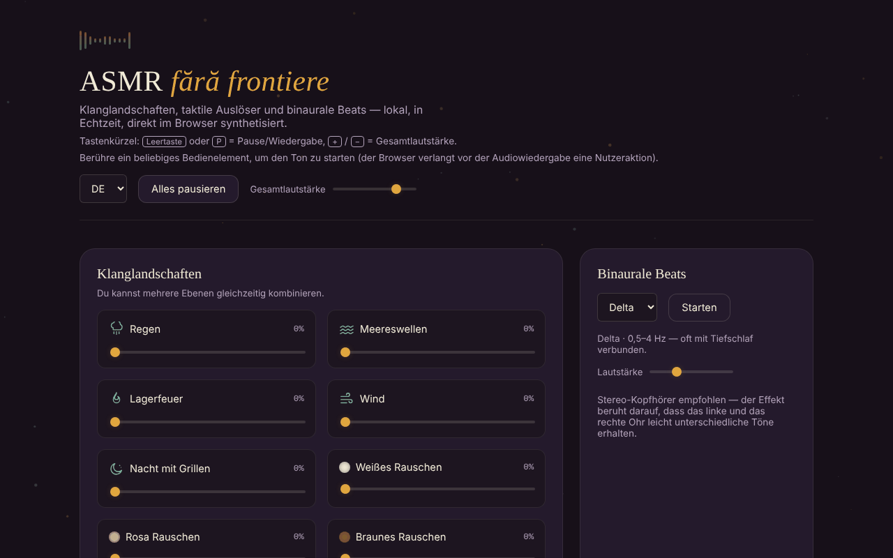

# ASMR fără frontiere

[English](README.md) · [Română](README.ro.md) · [Français](README.fr.md) · [Italiano](README.it.md) · [Español](README.es.md) · [Português](README.pt.md) · **Deutsch** · [Magyar](README.hu.md)

**Version:** 2.0.0 · **Zuletzt aktualisiert:** 2026-10-26

Oberflächensprachen: **Română, English, Français, Italiano, Español, Português (PT), Deutsch, Magyar**

Klanglandschaften, taktile Trigger und binaurale Beats, lokal im Browser synthetisiert, in einer einzigen HTML-Datei.

**Online:** https://chiuta.github.io/ASMR/

## Was es ist

Ein Klangmixer zur Entspannung, in schlichtem JavaScript geschrieben. Der Klang wird nicht aus Audiodateien abgespielt: Er wird in Echtzeit über die Web Audio API erzeugt. Die App vereint kombinierbare Ambient-Ebenen, kurze, per Berührung ausgelöste Klänge, interaktive visuelle Effekte, binaurale Beats und einen Einschlaf-Timer.

## Funktionen

- **Klanglandschaften** (kombinierbare Ebenen, jede mit eigener Lautstärke): Regen, Meereswellen, Lagerfeuer, Wind, Nacht mit Grillen, Weißes Rauschen, Rosa Rauschen, Braunes Rauschen.
- **Trigger**: Klopfen auf Holz, Klopfen auf Glas, Klopfen auf den Tisch, Wassertropfen, Umblättern einer Seite, Tastaturklick, Papierrascheln und Bürsten (durchgehende Textur, solange du gedrückt hältst).
- **Visuelle ASMR-Effekte**: Kinetischer Sand, Luftpolsterfolie, Tinte im Wasser, Knackendes Eis, Symmetrisches Muster, Lichtwellen; Schaltfläche **Löschen**.
- **Binaurale Beats**: die Bänder Delta, Theta, Alpha und Beta, mit getrennter Lautstärke und Schaltfläche **Starten**. Die App empfiehlt Stereo-Kopfhörer.
- **Einschlaf-Timer**: 15, 30, 45, 60 oder 90 Min. oder „Aus"; Anzeige der verbleibenden Zeit.
- **Voreinstellungen**: sechs integrierte Voreinstellungen (Nachtregen, Sturm auf dem Meer, Lagerfeuer, Konzentration, Einschlafen, Stille) und eigene Voreinstellungen, mit einem Namen gespeichert (maximal 24 Zeichen).
- **Per Link teilbarer Mix**: „Mix-Link kopieren" erzeugt eine Adresse mit `#mix=…` (die aktiven Ebenen mit Lautstärke und, falls eingeschaltet, das binaurale Band). Wer den Link öffnet, sieht die Schaltfläche „Mix aus dem Link abspielen"; der Ton startet nicht von selbst. Die Werte im Link werden validiert (nur bekannte Ebenen, Lautstärke 1–100). Die Voreinstellungen zeigen Statusmeldungen (fehlender Name, gespeichert, Link kopiert).
- Schaltfläche **Alles pausieren / Alles abspielen** und **Gesamtlautstärke**; Schaltfläche **Alle Ebenen stoppen** (setzt die Ebenen auf 0 und stoppt die binauralen Beats).
- Timer mit **benutzerdefinierter Dauer** (1–480 Min., mit Fehlermeldung bei ungültigem Wert); der Timer hat die Rolle `timer` für Screenreader.
- Die Voreinstellung **Letzte Kombination**: Der letzte Mix mit mindestens einer aktiven Ebene oder aktiven Beats wird automatisch gespeichert und lässt sich mit einem Klick wieder aufnehmen.
- Globale Kürzel: **Leertaste** oder **P** = Pause/Wiedergabe, **+** / **−** = Gesamtlautstärke (±5), wenn der Fokus nicht auf einem Feld oder einer Schaltfläche liegt.
- Die Tasten Enter und Leertaste aktivieren die Trigger, wenn diese den Fokus haben.

## Neue Funktionen (v1.1.0)

- **WAV-Aufnahme des aktuellen Mixes**: nimmt die Ausgabe der App in Echtzeit auf (die aktiven Ebenen, die binauralen Beats und die in dieser Zeit berührten Trigger), Stereo, 16 Bit, für die gewählte Dauer (15 s – 5 Min.) oder bis „Stoppen und speichern"; die Datei `asmr-mix-*.wav` wird am Ende heruntergeladen. Ohne aktiven Ton lehnt sie mit einer Meldung ab. Einschränkung: Die Aufnahme dauert so lange wie der Ton (Echtzeit, kein beschleunigtes Rendern) und verwendet `ScriptProcessorNode`; fehlt dieser im Browser, erscheint eine Meldung.
- **QR für den Mix**: erzeugt einen QR-Code mit den Ebenenpegeln (und den binauralen Beats) und kann ihn aus einem Bild oder aus eingefügtem Text wieder einlesen; der QR ohne Weblink enthält nur `#mix=…`. Ein Bild ohne QR ändert nichts.
- **Sprachgeführte Atemanleitung** (`FFF.tts`): spricht „Einatmen" (4 s) und „Ausatmen" (6 s) in langsamem Rhythmus, mit sichtbarem Text und `aria-pressed`; ohne Sprachsynthese erscheint eine Meldung. Sie ist keine medizinische Anweisung.
- **Kit**: Transparenz und `.fff.json`-Sicherung (die Voreinstellungen sind indiziert), Module `core, label, bundle, qr, tts`.
- **Sprachen und Übersetzungen**: Die App hat nur eine rumänische Oberfläche; die neuen Texte sind auf Rumänisch. Der Dialog „Transparenz" des Kits liegt in 8 Sprachen vor (maschinelle Übersetzungen, **nicht von Muttersprachlern geprüft**).

## Bedienungsanleitung

1. Öffne die Seite und berühre ein beliebiges Bedienelement: Der Browser verlangt eine Nutzergeste, bevor er Audio abspielt.
2. Ziehe unter „Klanglandschaften" den Regler einer oder mehrerer Ebenen hoch; stelle die „Gesamtlautstärke" ein.
3. Berühre unter „Trigger" eine Schaltfläche für einen kurzen Klang; halte bei „Bürsten" so lange gedrückt, wie du die Textur willst.
4. Wähle unter „Visuelle ASMR-Effekte" einen Effekt und interagiere mit ihm; „Löschen" setzt ihn zurück.
5. Wähle unter „Binaurale Beats" das Band (Delta, Theta, Alpha oder Beta), passe die Lautstärke an und drücke **Starten**.
6. Zum Einschlafen wähle die Dauer unter „Einschlaf-Timer"; der Ton stoppt, wenn die Zeit abläuft. „Aus" bricht den Timer ab.
7. Drücke unter „Voreinstellungen" eine integrierte Voreinstellung oder schreibe einen Namen (Enter oder **Speichern**), um deine aktuelle Kombination aus Ebenen und das aktive binaurale Band zu speichern.
8. **Alles pausieren** hält vorübergehend alle Klänge an; dieselbe Schaltfläche setzt sie fort.

## Hinweis

Informations- und Entspannungsinhalt; er ersetzt keinen ärztlichen Rat. Die Beschreibungen der binauralen Bänder (Delta, Theta, Alpha, Beta) sind verbreitete Zuordnungen; die wissenschaftlichen Belege für ihre Wirkung auf Schlaf, Konzentration oder Stimmung sind begrenzt, und die App ist kein Medizinprodukt und behandelt keine Erkrankung. Halte die Lautstärke auf einem angenehmen Niveau; bei Epilepsie, Tinnitus oder einer anderen Erkrankung hole vor längerer Nutzung ärztlichen Rat ein.

## Datenschutz und Netzwerk

- Das „ohne Grenzen"-Kit (`fff-kit`, Module `core, label, bundle, qr, tts`) ist in `index.html` eingefügt: Es stellt keine Netzwerkanfragen. Der Dialog „Transparenz" (Klick auf die Version) zeigt das deklarierte Netzwerk (0 externe Anfragen), die `localStorage`-Schlüssel, den SHA-256 der Datei und bietet eine `.fff.json`-Sicherung (optional mit Passwort verschlüsselt, AES-GCM). QR-Codes werden lokal erzeugt und gelesen; das Lesen erfolgt nur aus einem vom Nutzer gewählten Bild, ohne Kamera.

- **Lokaler Speicher (localStorage):** zwei Schlüssel: `asmr_ff_presets` (deine gespeicherten Voreinstellungen: Name, Ebenenpegel, binaurales Band) und `asmr_ff_last` (die letzte Kombination: Pegel und Band, ohne Namen). Blockiert der Browser den Speicher, bleiben die Voreinstellungen bis zum Neuladen nur im Arbeitsspeicher.
- **Netzwerk:** Im Code gibt es keine Netzwerkanfragen (`fetch`), keine von außen geladenen Skripte, Schriften oder Bilder und keine externen Links. Es gibt keine Analytics.

## Lokale Ausführung / offline

Lade `index.html` herunter und öffne sie im Browser; sie braucht kein Internet. Erforderlich ist ein Browser mit Unterstützung der Web Audio API und aktiviertem JavaScript.

## Verlauf / Changelog

- 1.2.3 — 2026-10-22: fff-kit 1.1.4: Touch-Ziele und Mindestschriftgröße
- 1.2.2 — 2026-10-22: fff-kit 1.1.2: PBKDF2 mit 600.000 Iterationen, Schutz vor Clickjacking
- 1.2.1 — 2026-10-22: Barrierefreiheit und Mobilgeräte: das versteckte Feld für das QR-Bild ist beschriftet, Tastenkürzel und Touch-Ziele der Schieberegler erfüllen die Mindestgröße (Text ≥ 12 px, Ziele ≥ 24 px).
- 1.1.1 — 2026-10-18: Der Import eines `.fff.json`-Pakets führt die importierten Voreinstellungen mit den eigenen zusammen (gleicher Name = durch den aus der Datei ersetzt; Obergrenze 50), statt sie zu löschen; Tests.
- 1.1.0 — 2026-10-14: WAV-Aufnahme, QR für den Mix, sprachgeführte Atemanleitung, „ohne Grenzen"-Kit. Tests: `tests/fff-r8.test.mjs`.

### 12. Oktober 2026 (v1.0.0)
- 1.0.0 — 2026-10-12: Version und Datum der letzten Aktualisierung werden in der App angezeigt

### 11. Oktober 2026 (dritter Eintrag)
- Per Link teilbarer Mix, nur beim Drücken einer Schaltfläche angewendet; Statusmeldungen bei den Voreinstellungen (zuvor gab das Speichern ohne Namen keine Rückmeldung).

### 11. Oktober 2026
- Neu: benutzerdefinierte Dauer für den Timer, „Alle Ebenen stoppen", Voreinstellung „Letzte Kombination", Tastenkürzel; CSP mit Hash für das Skript (ohne `'unsafe-inline'` bei Skripten). Screenshot aktualisiert.
- Strikte CSP hinzugefügt (ohne Netzwerk, ohne externe Ressourcen); Prüfung: axe 0 Verstöße, keine Konsolenfehler, kein horizontaler Überlauf bei 360 px.
- Die Qualität des synthetisierten Klangs lässt sich nicht automatisch bewerten; in dieser Runde unverändert.

## Lizenz

MIT für den Code und die Struktur der App — siehe Datei `LICENSE`. Eventuell in die Datei eingebundene Bibliotheken Dritter behalten ihre eigenen Lizenzen.

Die App selbst enthält nur den Hinweis: „Die Datei gehört dir. 100 % lokal — ohne Konto, ohne Telemetrie, ohne Server."

## Autor

Alexio — Alexandru-Ionuț Chiuță. Kontakt: alexio@trom.tf

## Zusammenfassung

ASMR fără frontiere ist ein ASMR-Klangmixer in einer einzigen Datei: geschichtete Klanglandschaften (Regen, Meer, Feuer, Wind, Grillen, weißes/rosa/braunes Rauschen), Berührungs-Trigger, interaktive visuelle Effekte, binaurale Beats (Delta/Theta/Alpha/Beta) und ein Einschlaf-Timer, alles live mit der Web Audio API synthetisiert. Sie stellt keine Netzwerkanfragen; nur vom Nutzer gespeicherte Voreinstellungen werden in localStorage gehalten. Die Oberfläche ist auf Rumänisch. Lizenz: MIT.

Audit: 2026-10-10 — Code geprüft (keine Netzwerkanfragen), Barrierefreiheit (axe) und Funktion; Hinweis hinzugefügt.
