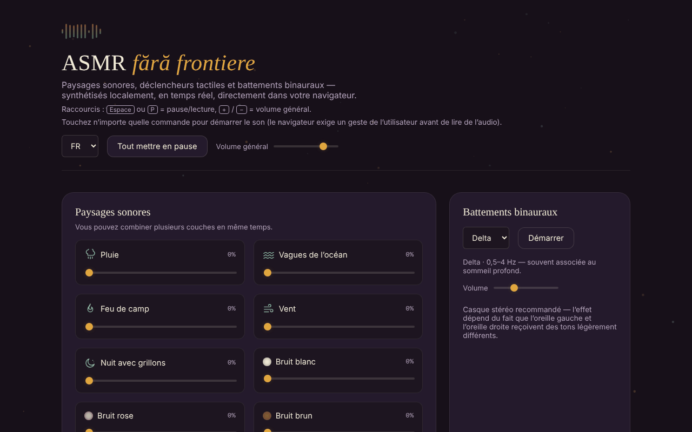

# ASMR fără frontiere

[English](README.md) · [Română](README.ro.md) · **Français** · [Italiano](README.it.md) · [Español](README.es.md) · [Português](README.pt.md) · [Deutsch](README.de.md) · [Magyar](README.hu.md)

**Version :** 2.1.0 · **Dernière mise à jour :** 2026-10-27

**État:** stable · **Hors ligne:** complet

Langues de l'interface : **Română, English, Français, Italiano, Español, Português (PT), Deutsch, Magyar**

Paysages sonores, déclencheurs tactiles et battements binauraux, synthétisés localement dans le navigateur, dans un seul fichier HTML.

**En ligne :** https://chiuta.github.io/ASMR/

## De quoi s'agit-il

Un mixeur de sons pour la détente, écrit en JavaScript simple. Le son n'est pas lu à partir de fichiers audio : il est généré en temps réel via la Web Audio API. L'application réunit des couches d'ambiance combinables, des sons brefs déclenchés au toucher, des effets visuels interactifs, des battements binauraux et une minuterie d'endormissement.

## Fonctionnalités

- **Paysages sonores** (couches combinables, chacune avec son propre volume) : Pluie, Vagues de l'océan, Feu de camp, Vent, Nuit avec grillons, Bruit blanc, Bruit rose, Bruit brun.
- **Déclencheurs** : Tapotement sur bois, Tapotement sur verre, Tapotement sur table, Goutte d'eau, Page tournée, Clic de clavier, Froissement de papier et Brossage (texture continue tant que vous maintenez appuyé).
- **Effets visuels ASMR** : Sable cinétique, Papier bulle, Encre dans l'eau, Glace qui craque, Motif symétrique, Vagues de lumière ; bouton **Effacer**.
- **Battements binauraux** : les bandes Delta, Theta, Alpha et Beta, avec un volume séparé et un bouton **Démarrer**. L'application recommande un casque stéréo.
- **Minuterie d'endormissement** : 15, 30, 45, 60 ou 90 min, ou « Arrêt » ; affichage du temps restant.
- **Préréglages** : six préréglages intégrés (Pluie de nuit, Tempête sur l'océan, Feu de camp, Concentration, Endormissement, Calme) et vos propres préréglages, enregistrés avec un nom (24 caractères maximum).
- **Mix partageable par lien** : « Copier le lien du mix » génère une adresse avec `#mix=…` (les couches actives avec leur volume et, si elle est activée, la bande binaurale). Celui qui ouvre le lien voit le bouton « Lire le mix du lien » ; le son ne démarre pas tout seul. Les valeurs du lien sont validées (uniquement des couches connues, volume 1–100). Les préréglages affichent des messages d'état (nom manquant, enregistré, lien copié).
- Bouton **Tout mettre en pause / Tout lire** et **Volume général** ; bouton **Arrêter toutes les couches** (ramène les couches à 0 et arrête les battements binauraux).
- Minuterie avec **durée personnalisée** (1–480 min, avec un message d'erreur en cas de valeur invalide) ; la minuterie a le rôle `timer` pour les lecteurs d'écran.
- Le préréglage **Dernière combinaison** : le dernier mix ayant au moins une couche ou des battements actifs est conservé automatiquement et peut être repris en un clic.
- Raccourcis globaux : **Espace** ou **P** = pause/lecture, **+** / **−** = volume général (±5), lorsque le focus n'est pas sur un champ ou un bouton.
- Les touches Entrée et Espace activent les déclencheurs lorsqu'ils ont le focus.

## Nouveautés (v1.1.0)

- **Enregistrement WAV du mix en cours** : capture en temps réel la sortie de l'application (les couches actives, les battements binauraux et les déclencheurs touchés pendant ce temps), en stéréo, 16 bits, pour la durée choisie (15 s – 5 min) ou jusqu'à « Arrêter et enregistrer » ; le fichier `asmr-mix-*.wav` est téléchargé à la fin. Sans son actif, il refuse avec un message. Limite : l'enregistrement dure aussi longtemps que le son (temps réel, pas rendu accéléré) et utilise `ScriptProcessorNode` ; si le navigateur ne l'a pas, un message apparaît.
- **QR pour le mix** : génère un code QR avec les niveaux des couches (et les battements binauraux) et peut le relire à partir d'une image ou d'un texte collé ; le QR sans lien web ne contient que `#mix=…`. Une image sans QR ne modifie rien.
- **Guide vocal de respiration** (`FFF.tts`) : prononce « Inspirez » (4 s) et « Expirez » (6 s) à un rythme lent, avec texte visible et `aria-pressed` ; sans synthèse vocale, un message apparaît. Ce n'est pas une indication médicale.
- **Kit** : Transparence et sauvegarde `.fff.json` (les préréglages sont indexés), modules `core, label, bundle, qr, tts`.
- **Langues et traductions** : l'application n'a qu'une interface en roumain ; les nouveaux textes sont en roumain. La fenêtre « Transparence » du kit est en 8 langues (traductions automatiques, **non vérifiées par des locuteurs natifs**).

## Mode d'emploi

1. Ouvrez la page et touchez n'importe quelle commande : le navigateur exige un geste de l'utilisateur avant de lire de l'audio.
2. Dans « Paysages sonores », montez le curseur d'une ou de plusieurs couches ; réglez le « Volume général ».
3. Dans « Déclencheurs », touchez un bouton pour un son bref ; pour « Brossage », maintenez appuyé aussi longtemps que vous voulez la texture.
4. Dans « Effets visuels ASMR », choisissez un effet et interagissez avec lui ; « Effacer » le réinitialise.
5. Dans « Battements binauraux », choisissez la bande (Delta, Theta, Alpha ou Beta), ajustez le volume et appuyez sur **Démarrer**.
6. Pour vous endormir, choisissez la durée dans « Minuterie d'endormissement » ; le son s'arrête à l'expiration du délai. « Arrêt » annule la minuterie.
7. Dans « Préréglages », appuyez sur un préréglage intégré ou saisissez un nom (Entrée ou **Enregistrer**) pour sauvegarder votre combinaison actuelle de couches et la bande binaurale active.
8. **Tout mettre en pause** arrête temporairement tous les sons ; le même bouton les reprend.

## Avertissement

Contenu informatif et de détente ; il ne remplace pas un avis médical. Les descriptions des bandes binaurales (Delta, Theta, Alpha, Beta) sont des associations populaires ; les preuves scientifiques de leur effet sur le sommeil, la concentration ou l'humeur sont limitées, et l'application n'est pas un dispositif médical et ne traite aucune affection. Gardez le volume à un niveau confortable ; si vous avez de l'épilepsie, des acouphènes ou une autre affection, demandez l'avis d'un médecin avant un usage prolongé.

## Confidentialité et réseau

- Le kit « sans frontières » (`fff-kit`, modules `core, label, bundle, qr, tts`) est intégré dans `index.html` : il n'effectue aucune requête réseau. La fenêtre « Transparence » (clic sur la version) montre le réseau déclaré (0 requête externe), les clés de `localStorage`, le SHA-256 du fichier et propose une sauvegarde `.fff.json` (éventuellement chiffrée par mot de passe, AES-GCM). Les codes QR sont générés et lus localement ; la lecture se fait uniquement à partir d'une image choisie par l'utilisateur, sans caméra.

- **Stockage local (localStorage) :** deux clés : `asmr_ff_presets` (vos préréglages enregistrés : nom, niveaux des couches, bande binaurale) et `asmr_ff_last` (la dernière combinaison : niveaux et bande, sans nom). Si le navigateur bloque le stockage, les préréglages restent uniquement en mémoire jusqu'au rechargement.
- **Réseau :** dans le code, il n'y a aucune requête réseau (`fetch`), ni script, police ou image chargés depuis l'extérieur, ni lien externe. Il n'y a pas d'analytique.

## Exécution en local / hors ligne

Téléchargez `index.html` et ouvrez-le dans un navigateur ; il n'a pas besoin d'internet. Un navigateur prenant en charge la Web Audio API, avec JavaScript activé, est nécessaire.

## Nouveaux sons et fondu de sortie réglable (2.1.0)

Trois nouvelles couches, synthétisées localement : **Ruisseau**, **Ventilateur** et **Tonnerre lointain** (grondements rares, seulement tant que la couche est active). **Fondu de sortie réglable** à la fin de la minuterie d’endormissement : 10 s, 30 s (par défaut), 2 min ou 5 min ; le choix est conservé dans `localStorage` (`asmr_ff_fade`). La minuterie existait déjà (15–90 min ou durée libre 1–480 min) ; si le fondu est plus long que le temps restant, il commence immédiatement. Les nouvelles couches font automatiquement partie des préréglages, du lien `#mix=`, du code QR et des scènes.

## Voir aussi : applications voisines (non fusionnées)

Ces applications se recoupent par leur but (son apaisant pour la détente et le sommeil) mais fonctionnent différemment et n’ont **pas été fusionnées**. **ASMR** est un mixeur de paysages sonores et de déclencheurs tactiles (ASMR), avec scènes temporelles et minuterie d’endormissement. Voir aussi : [CalmWaves](https://chiuta.github.io/CalmWaves/) — une composition ambiante générative (intention, palette tonale, densité) avec code de variante, voix synthétisée et visualisations; [BorderlessMelodies](https://chiuta.github.io/BorderlessMelodies/) — un compositeur de musique originale par genre et graine (export WAV/FLAC/MIDI, codes partageables), avec couches de relaxation optionnelles; [Aurora](https://chiuta.github.io/Aurora/) — tons des chakras, battements binauraux et guide de respiration pour la méditation. Choisissez selon le besoin : paysages et déclencheurs = ASMR ; pièce ambiante générée = CalmWaves ; musique par genre/graine = BorderlessMelodies ; méditation sur les chakras = Aurora.

## Historique / Changelog
- **2.1.0 — 2026-10-27 :** nouvelles couches (Ruisseau, Ventilateur, Tonnerre lointain) ; durée du fondu de sortie de la minuterie réglable (10 s / 30 s / 2 min / 5 min) ; note « voir aussi » (CalmWaves, BorderlessMelodies, Aurora), sans fusion ; lignes État/Hors ligne ; CHANGELOG.md (précédente : v2.0.0).

- 1.2.3 — 2026-10-22 : fff-kit 1.1.4 : cibles tactiles et taille de texte minimale
- 1.2.2 — 2026-10-22 : fff-kit 1.1.2 : PBKDF2 600 000 itérations, protection anti-clickjacking
- 1.2.1 — 2026-10-22: finitions d’accessibilité et mobile : le champ caché pour l’image QR est étiqueté, les touches de raccourci et les cibles tactiles des curseurs respectent la taille minimale (texte ≥ 12 px, cibles ≥ 24 px).
- 1.1.1 — 2026-10-18 : l'import d'un paquet `.fff.json` fusionne les préréglages importés avec les vôtres (même nom = remplacé par celui du fichier ; plafond de 50) au lieu de les effacer ; tests.
- 1.1.0 — 2026-10-14 : enregistrement WAV, QR pour le mix, guide vocal de respiration, kit « sans frontières ». Tests : `tests/fff-r8.test.mjs`.

### 12 octobre 2026 (v1.0.0)
- 1.0.0 — 2026-10-12 : la version et la date de la dernière mise à jour sont affichées dans l'application

### 11 octobre 2026 (troisième entrée)
- Mix partageable par lien, appliqué uniquement à l'appui sur un bouton ; messages d'état pour les préréglages (auparavant, l'enregistrement sans nom ne donnait aucune réponse).

### 11 octobre 2026
- Nouveau : durée personnalisée pour la minuterie, « Arrêter toutes les couches », préréglage « Dernière combinaison », raccourcis clavier ; CSP avec empreinte pour le script (sans `'unsafe-inline'` pour les scripts). Capture d'écran mise à jour.
- Ajout d'une CSP stricte (sans réseau, sans ressources externes) ; vérification : axe 0 violation, aucune erreur dans la console, pas de débordement horizontal à 360 px.
- La qualité du son synthétisé ne peut pas être évaluée automatiquement ; inchangée dans cette série.

## Licence

MIT pour le code et la structure de l'application — voir le fichier `LICENSE`. Les éventuelles bibliothèques tierces incluses dans le fichier conservent leurs propres licences.

L'application elle-même ne contient que la mention : « Le fichier est à toi. 100 % local — sans compte, sans télémétrie, sans serveur. »

## Auteur

Alexio — Alexandru-Ionuț Chiuță. Contact : alexio@trom.tf

## Résumé

ASMR fără frontiere est un mixeur de sons ASMR en un seul fichier : paysages sonores en couches (pluie, océan, feu, vent, grillons, bruit blanc/rose/brun), déclencheurs tactiles, effets visuels interactifs, battements binauraux (Delta/Theta/Alpha/Beta) et minuterie d'endormissement, le tout synthétisé en direct avec la Web Audio API. Il n'effectue aucune requête réseau ; seuls les préréglages enregistrés par l'utilisateur sont conservés dans localStorage. L'interface est en roumain. Licence : MIT.

Audit : 2026-10-10 — code vérifié (aucune requête réseau), accessibilité (axe) et fonctionnement ; avertissement ajouté.
