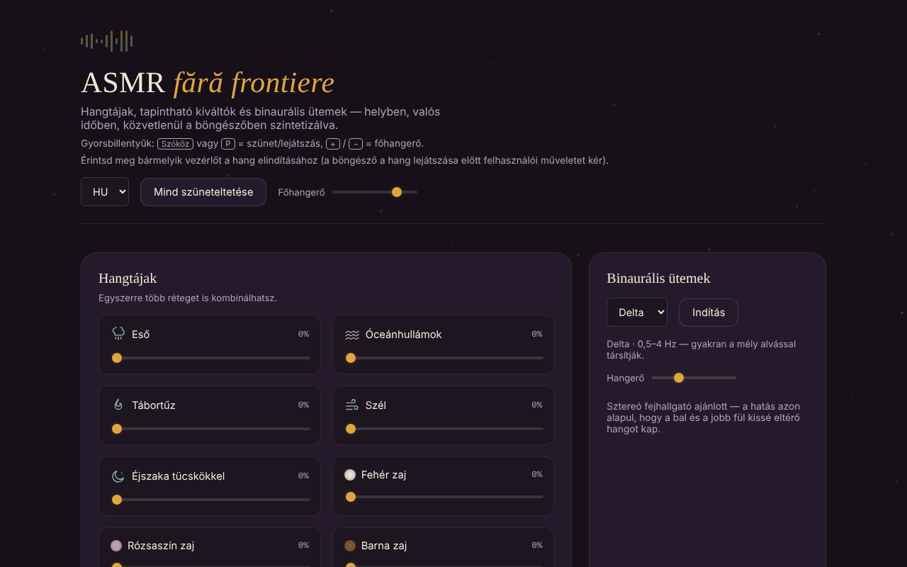

# ASMR fără frontiere

[English](README.md) · [Română](README.ro.md) · [Français](README.fr.md) · [Italiano](README.it.md) · [Español](README.es.md) · [Português](README.pt.md) · [Deutsch](README.de.md) · **Magyar**

**Verzió:** 1.2.4 · **Utolsó frissítés:** 2026-10-23

A felület nyelvei: **Română, English, Français, Italiano, Español, Português (PT), Deutsch, Magyar**

Hangtájképek, tapintási kiváltók és binaurális ütemek, helyben, a böngészőben szintetizálva, egyetlen HTML-fájlban.

**Élő változat:** https://chiuta.github.io/ASMR/

## Mi ez

Relaxációs hangkeverő, egyszerű JavaScriptben írva. A hang nem hangfájlokból szólal meg: valós időben jön létre a Web Audio API segítségével. Az alkalmazás kombinálható ambient rétegeket, érintésre kiváltott rövid hangokat, interaktív vizuális effekteket, binaurális ütemeket és elalvási időzítőt egyesít.

## Funkciók

- **Hangtájképek** (kombinálható rétegek, mindegyik saját hangerővel): Eső, Óceánhullámok, Tábortűz, Szél, Éjszaka tücskökkel, Fehér zaj, Rózsaszín zaj, Barna zaj.
- **Kiváltók**: Fa kopogtatása, Üveg kopogtatása, Asztal kopogtatása, Vízcsepp, Lapozás, Billentyűkattanás, Papírzizegés és Kefélés (folyamatos textúra, amíg nyomva tartod).
- **ASMR vizuális effektek**: Kinetikus homok, Buborékfólia, Tinta a vízben, Repedő jég, Szimmetrikus minta, Fényhullámok; **Törlés** gomb.
- **Binaurális ütemek**: a Delta, Theta, Alpha és Beta sávok, külön hangerővel és **Indítás** gombbal. Az alkalmazás sztereó fejhallgatót ajánl.
- **Elalvási időzítő**: 15, 30, 45, 60 vagy 90 perc, vagy „Ki”; a hátralévő idő kijelzése.
- **Előbeállítások**: hat beépített előbeállítás (Éjszakai eső, Vihar az óceánon, Tábortűz, Koncentráció, Elalvás, Csend) és saját előbeállítások, névvel mentve (legfeljebb 24 karakter).
- **Hivatkozással megosztható keverék**: a „Keverék hivatkozásának másolása” egy `#mix=…` címet hoz létre (az aktív rétegek hangerővel, és ha be van kapcsolva, a binaurális sáv). Aki megnyitja a hivatkozást, látja a „Keverék lejátszása a hivatkozásból” gombot; a hang nem indul el magától. A hivatkozásban lévő értékeket ellenőrzi (csak ismert rétegek, hangerő 1–100). Az előbeállítások állapotüzeneteket mutatnak (hiányzó név, mentve, hivatkozás másolva).
- **Mindent szüneteltet / Mindent lejátszik** gomb és **Főhangerő**; **Minden réteg leállítása** gomb (a rétegeket 0-ra állítja, és leállítja a binaurális ütemeket).
- Időzítő **egyéni időtartammal** (1–480 perc, érvénytelen értéknél hibaüzenettel); az időzítő `timer` szerepű a képernyőolvasók számára.
- Az **Utolsó kombináció** előbeállítás: az utolsó, legalább egy aktív réteggel vagy ütemmel rendelkező keverék automatikusan megmarad, és egyetlen kattintással folytatható.
- Globális billentyűparancsok: **Szóköz** vagy **P** = szünet/lejátszás, **+** / **−** = főhangerő (±5), ha a fókusz nem mezőn vagy gombon van.
- Az Enter és a Szóköz billentyű aktiválja a kiváltókat, ha azokon van a fókusz.

## Újdonságok (v1.1.0)

- **Az aktuális keverék WAV-felvétele**: valós időben rögzíti az alkalmazás kimenetét (az aktív rétegeket, a binaurális ütemeket és az eközben megérintett kiváltókat), sztereó, 16 bites, a választott időtartamig (15 mp – 5 perc) vagy a „Leállítás és mentés”-ig; az `asmr-mix-*.wav` fájl a végén letöltődik. Aktív hang nélkül üzenettel elutasítja. Korlát: a felvétel addig tart, ameddig a hang (valós idő, nem gyorsított renderelés), és `ScriptProcessorNode`-ot használ; ha a böngésző nem rendelkezik vele, üzenet jelenik meg.
- **QR a keverékhez**: QR-kódot hoz létre a rétegek szintjeivel (és a binaurális ütemekkel), és képből vagy beillesztett szövegből vissza is tudja olvasni; a webes hivatkozás nélküli QR csak a `#mix=…` részt tartalmazza. A QR nélküli kép semmit sem módosít.
- **Hangos légzésvezető** (`FFF.tts`): lassú ütemben kimondja a „Belégzés” (4 mp) és a „Kilégzés” (6 mp) szavakat, látható szöveggel és `aria-pressed` jelöléssel; beszédszintézis nélkül üzenet jelenik meg. Nem orvosi javaslat.
- **Kit**: Átláthatóság és `.fff.json` mentés (az előbeállítások indexeltek), `core, label, bundle, qr, tts` modulok.
- **Nyelvek és fordítások**: az alkalmazás felülete csak román nyelvű; az új szövegek románul vannak. A kit „Átláthatóság” párbeszédablaka 8 nyelven érhető el (gépi fordítások, **anyanyelvi beszélők által nem ellenőrizve**).

## Használati útmutató

1. Nyisd meg az oldalt, és érints meg egy tetszőleges vezérlőt: a böngésző felhasználói műveletet követel meg, mielőtt hangot játszana le.
2. A „Hangtájképek” alatt húzd feljebb egy vagy több réteg csúszkáját; állítsd be a „Főhangerőt”.
3. A „Kiváltók” alatt érints meg egy gombot egy rövid hangért; a „Kefélés”-nél tartsd nyomva, ameddig a textúrát szeretnéd.
4. Az „ASMR vizuális effektek” alatt válassz egy effektet, és lépj vele interakcióba; a „Törlés” visszaállítja.
5. A „Binaurális ütemek” alatt válaszd ki a sávot (Delta, Theta, Alpha vagy Beta), állítsd be a hangerőt, és nyomd meg az **Indítás** gombot.
6. Elalváshoz válaszd ki az időtartamot az „Elalvási időzítő” alatt; a hang az idő lejártakor leáll. A „Ki” megszünteti az időzítőt.
7. Az „Előbeállítások” alatt nyomj meg egy beépített előbeállítást, vagy írj be egy nevet (Enter vagy **Mentés**), hogy elmentsd a rétegek aktuális kombinációját és az aktív binaurális sávot.
8. A **Mindent szüneteltet** ideiglenesen leállít minden hangot; ugyanez a gomb folytatja őket.

## Figyelmeztetés

Tájékoztató és relaxációs tartalom; nem helyettesíti az orvosi tanácsot. A binaurális sávok (Delta, Theta, Alpha, Beta) leírásai közkeletű asszociációk; az alvásra, a koncentrációra vagy a hangulatra gyakorolt hatásukra vonatkozó tudományos bizonyítékok korlátozottak, az alkalmazás pedig nem orvostechnikai eszköz, és semmilyen betegséget nem kezel. Tartsd a hangerőt kényelmes szinten; ha epilepsziád, fülzúgásod vagy más betegséged van, hosszabb használat előtt kérj orvosi tanácsot.

## Adatvédelem és hálózat

- A „határok nélküli” kit (`fff-kit`, `core, label, bundle, qr, tts` modulok) be van illesztve az `index.html` fájlba: nem küld hálózati kéréseket. Az „Átláthatóság” párbeszédablak (a verzióra kattintva) megmutatja a deklarált hálózatot (0 külső kérés), a `localStorage` kulcsait, a fájl SHA-256 értékét, és `.fff.json` biztonsági mentést kínál (opcionálisan jelszóval titkosítva, AES-GCM). A QR-kódok helyben jönnek létre és olvashatók be; az olvasás csak a felhasználó által választott képből történik, kamera nélkül.

- **Helyi tárolás (localStorage):** két kulcs: `asmr_ff_presets` (a mentett előbeállításaid: név, rétegszintek, binaurális sáv) és `asmr_ff_last` (az utolsó kombináció: szintek és sáv, név nélkül). Ha a böngésző blokkolja a tárolást, az előbeállítások csak a memóriában maradnak az újratöltésig.
- **Hálózat:** a kódban nincsenek hálózati kérések (`fetch`), kívülről betöltött szkriptek, betűtípusok vagy képek, sem külső hivatkozások. Nincs analitika.

## Futtatás helyben / offline

Töltsd le az `index.html` fájlt, és nyisd meg böngészőben; nincs szüksége internetre. Web Audio API-t támogató, bekapcsolt JavaScriptű böngésző szükséges.

## Előzmények / Changelog

- 1.2.3 — 2026-10-22: fff-kit 1.1.4: érintési célpontok és minimális szövegméret
- 1.2.2 — 2026-10-22: fff-kit 1.1.2: PBKDF2 600 000 iteráció, clickjacking elleni védelem
- 1.2.1 — 2026-10-22: kisegítő lehetőségek és mobil finomítások: a QR-kép rejtett mezője fel van címkézve, a gyorsbillentyűk és a csúszkák érintési felületei elérik a minimális méretet (szöveg ≥ 12 px, felület ≥ 24 px).
- 1.1.1 — 2026-10-18: egy `.fff.json` csomag importálása összefésüli az importált előbeállításokat a sajátokkal (azonos név = a fájlból származóra cserélve; legfeljebb 50) ahelyett, hogy törölné őket; tesztek.
- 1.1.0 — 2026-10-14: WAV-felvétel, QR a keverékhez, hangos légzésvezető, „határok nélküli” kit. Tesztek: `tests/fff-r8.test.mjs`.

### 2026. október 12. (v1.0.0)
- 1.0.0 — 2026-10-12: a verzió és az utolsó frissítés dátuma megjelenik az alkalmazásban

### 2026. október 11. (harmadik bejegyzés)
- Hivatkozással megosztható keverék, amely csak gombnyomásra lép életbe; állapotüzenetek az előbeállításoknál (korábban a név nélküli mentés nem adott semmilyen választ).

### 2026. október 11.
- Új: egyéni időtartam az időzítőhöz, „Minden réteg leállítása”, „Utolsó kombináció” előbeállítás, billentyűparancsok; CSP hash-sel a szkripthez (a szkriptekhez `'unsafe-inline'` nélkül). A képernyőkép frissítve.
- Szigorú CSP hozzáadva (hálózat és külső erőforrások nélkül); ellenőrzés: axe 0 szabálysértés, nincs konzolhiba, nincs vízszintes túlnyúlás 360 px-en.
- A szintetizált hang minősége automatikusan nem értékelhető; ebben a körben változatlan.

## Licenc

MIT az alkalmazás kódjára és szerkezetére — lásd a `LICENSE` fájlt. A fájlban esetleg szereplő harmadik féltől származó könyvtárak megtartják saját licencüket.

Maga az alkalmazás csak ezt a megjegyzést tartalmazza: „A fájl a tiéd. 100%-ban helyi — fiók, telemetria és szerver nélkül.”

## Szerző

Alexio — Alexandru-Ionuț Chiuță. Elérhetőség: alexio@trom.tf

## Összefoglaló

Az ASMR fără frontiere egyfájlos ASMR-hangkeverő: rétegezett hangtájképek (eső, óceán, tűz, szél, tücskök, fehér/rózsaszín/barna zaj), érintéses kiváltók, interaktív vizuális effektek, binaurális ütemek (Delta/Theta/Alpha/Beta) és elalvási időzítő, mindez élőben szintetizálva a Web Audio API-val. Nem küld hálózati kéréseket; csak a felhasználó által mentett előbeállítások maradnak a localStorage-ban. A felület román nyelvű. Licenc: MIT.

Audit: 2026-10-10 — a kód ellenőrizve (nincsenek hálózati kérések), a hozzáférhetőség (axe) és a működés; figyelmeztetés hozzáadva.
