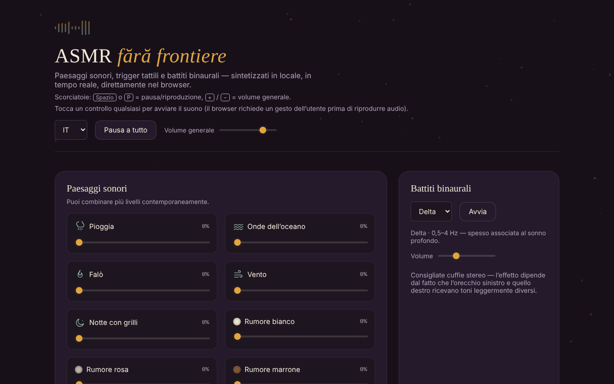

# ASMR fără frontiere

[English](README.md) · [Română](README.ro.md) · [Français](README.fr.md) · **Italiano** · [Español](README.es.md) · [Português](README.pt.md) · [Deutsch](README.de.md) · [Magyar](README.hu.md)

**Versione:** 2.2.1 · **Ultimo aggiornamento:** 2026-10-31

**Stato:** stabile · **Offline:** completo

Lingue dell'interfaccia: **Română, English, Français, Italiano, Español, Português (PT), Deutsch, Magyar**

Paesaggi sonori, stimoli tattili e battiti binaurali, sintetizzati in locale nel browser, in un unico file HTML.

**Online:** https://chiuta.github.io/ASMR/

## Che cos'è

Un mixer di suoni per il relax, scritto in JavaScript semplice. Il suono non viene riprodotto da file audio: è generato in tempo reale tramite la Web Audio API. L'app riunisce strati di ambiente combinabili, suoni brevi attivati al tocco, effetti visivi interattivi, battiti binaurali e un timer per addormentarsi.

## Funzioni

- **Paesaggi sonori** (strati combinabili, ciascuno con il proprio volume): Pioggia, Onde dell'oceano, Falò, Vento, Notte con grilli, Rumore bianco, Rumore rosa, Rumore marrone, Ruscello, Ventilatore, Tuono lontano.
- **Stimoli**: Picchiettio sul legno, Picchiettio sul vetro, Picchiettio sul tavolo, Goccia d'acqua, Pagina voltata, Clic di tastiera, Fruscio di carta e Spazzolatura (texture continua finché tieni premuto).
- **Effetti visivi ASMR**: Sabbia cinetica, Pluriball, Inchiostro nell'acqua, Ghiaccio che si crepa, Motivo simmetrico, Onde di luce; pulsante **Pulisci**.
- **Battiti binaurali**: le bande Delta, Theta, Alpha e Beta, con volume separato e pulsante **Avvia**. L'app consiglia cuffie stereo.
- **Timer per addormentarsi**: 15, 30, 45, 60 o 90 min, oppure «Spento»; visualizzazione del tempo rimanente.
- **Preset**: sei preset integrati (Pioggia notturna, Tempesta sull'oceano, Falò, Concentrazione, Addormentamento, Quiete) e preset personali, salvati con un nome (massimo 24 caratteri).
- **Mix condivisibile tramite link**: «Copia il link del mix» genera un indirizzo con `#mix=…` (gli strati attivi con volume e, se attiva, la banda binaurale). Chi apre il link vede il pulsante «Riproduci il mix dal link»; il suono non parte da solo. I valori nel link sono convalidati (solo strati noti, volume 1–100). I preset mostrano messaggi di stato (nome mancante, salvato, link copiato).
- Pulsante **Pausa tutto / Riproduci tutto** e **Volume generale**; pulsante **Ferma tutti gli strati** (porta gli strati a 0 e ferma i battiti binaurali).
- Timer con **durata personalizzata** (1–480 min, con messaggio di errore per un valore non valido); il timer ha il ruolo `timer` per gli screen reader.
- Il preset **Ultima combinazione**: l'ultimo mix con almeno uno strato o i battiti attivi viene conservato automaticamente e si può riprendere con un clic.
- Scorciatoie globali: **Spazio** o **P** = pausa/riproduzione, **+** / **−** = volume generale (±5), quando il focus non è su un campo o un pulsante.
- I tasti Invio e Spazio attivano gli stimoli quando questi hanno il focus.

## Novità (v1.1.0)

- 1.2.2 — 2026-10-22: fff-kit 1.1.2: PBKDF2 600.000 iterazioni, protezione anti-clickjacking
- **Registrazione WAV del mix corrente**: cattura in tempo reale l'uscita dell'app (gli strati attivi, i battiti binaurali e gli stimoli toccati nel frattempo), stereo, 16 bit, per la durata scelta (15 s – 5 min) o fino a «Ferma e salva»; il file `asmr-mix-*.wav` viene scaricato alla fine. Senza suono attivo rifiuta con un messaggio. Limite: la registrazione dura quanto il suono (tempo reale, non rendering accelerato) e usa `ScriptProcessorNode`; se il browser non lo ha, compare un messaggio.
- **QR per il mix**: genera un codice QR con i livelli degli strati (e i battiti binaurali) e può rileggerlo da un'immagine o da un testo incollato; il QR senza collegamento web contiene solo `#mix=…`. Un'immagine senza QR non modifica nulla.
- **Guida vocale del respiro** (`FFF.tts`): pronuncia «Inspira» (4 s) ed «Espira» (6 s) a ritmo lento, con testo visibile e `aria-pressed`; senza sintesi vocale compare un messaggio. Non è un'indicazione medica.
- **Kit**: Trasparenza e copia `.fff.json` (i preset sono indicizzati), moduli `core, label, bundle, qr, tts`.
- **Lingue e traduzioni**: l'app ha l'interfaccia solo in rumeno; i nuovi testi sono in rumeno. La finestra «Trasparenza» del kit è in 8 lingue (traduzioni automatiche, **non verificate da madrelingua**).

## Guida all'uso

1. Apri la pagina e tocca un controllo qualsiasi: il browser richiede un gesto dell'utente prima di riprodurre l'audio.
2. In «Paesaggi sonori» alza il cursore di uno o più strati; regola il «Volume generale».
3. In «Stimoli» tocca un pulsante per un suono breve; per «Spazzolatura» tieni premuto per quanto vuoi la texture.
4. In «Effetti visivi ASMR» scegli un effetto e interagisci con esso; «Pulisci» lo reimposta.
5. In «Battiti binaurali» scegli la banda (Delta, Theta, Alpha o Beta), regola il volume e premi **Avvia**.
6. Per addormentarti, scegli la durata in «Timer per addormentarsi»; il suono si ferma allo scadere del tempo. «Spento» annulla il timer.
7. In «Preset» premi un preset integrato oppure scrivi un nome (Invio o **Salva**) per salvare la tua combinazione corrente di strati e la banda binaurale attiva.
8. **Pausa tutto** ferma temporaneamente tutti i suoni; lo stesso pulsante li riprende.

## Avvertenza

Contenuto informativo e di relax; non sostituisce la consulenza medica. Le descrizioni delle bande binaurali (Delta, Theta, Alpha, Beta) sono associazioni popolari; le prove scientifiche sul loro effetto su sonno, concentrazione o umore sono limitate, e l'app non è un dispositivo medico e non cura alcuna condizione. Tieni il volume a un livello confortevole; se hai epilessia, acufene o un'altra condizione, chiedi il parere di un medico prima di un uso prolungato.

## Privacy e rete

- Il kit «senza frontiere» (`fff-kit`, moduli `core, label, bundle, qr, tts`) è incorporato in `index.html`: non effettua richieste di rete. La finestra «Trasparenza» (clic sulla versione) mostra la rete dichiarata (0 richieste esterne), le chiavi di `localStorage`, lo SHA-256 del file e offre una copia di sicurezza `.fff.json` (facoltativamente cifrata con password, AES-GCM). I codici QR vengono generati e letti in locale; la lettura avviene solo da un'immagine scelta dall'utente, senza fotocamera.

- **Archiviazione locale (localStorage):** due chiavi: `asmr_ff_presets` (i tuoi preset salvati: nome, livelli degli strati, banda binaurale) e `asmr_ff_last` (l'ultima combinazione: livelli e banda, senza nome). Se il browser blocca l'archiviazione, i preset restano solo in memoria fino al ricaricamento.
- **Rete:** nel codice non ci sono richieste di rete (`fetch`), né script, font o immagini caricati dall'esterno, né link esterni. Non c'è analytics.

## Esecuzione locale / offline

Scarica `index.html` e aprilo nel browser; non ha bisogno di internet. Serve un browser con supporto alla Web Audio API e JavaScript attivo.

## Il mio suono: un file audio locale (2.2.0)

«Il mio suono» carica un file audio dal dispositivo (massimo 25 MB e 5 minuti) e lo riproduce in loop, con volume proprio, tramite un limitatore (soglia −12 dB, rapporto 20). Segue il volume generale, la pausa e la dissolvenza del timer. Resta solo nella sessione: nulla viene salvato e **non** fa parte di preset, link `#mix=`, codice QR o scene. Testi nuovi scritti in RO/EN; traduzioni FR/IT/ES/PT/DE/HU automatiche (traduzione automatica, non verificata da madrelingua).

## Nuovi suoni e dissolvenza finale configurabile (2.1.0)

Tre nuovi strati, sintetizzati localmente: **Ruscello**, **Ventilatore** e **Tuono lontano** (rombi rari, solo mentre lo strato è attivo). **Dissolvenza finale configurabile** al termine del timer di spegnimento: 10 s, 30 s (predefinito), 2 min o 5 min; la scelta è salvata in `localStorage` (`asmr_ff_fade`). Il timer esisteva già (15–90 min o durata libera 1–480 min); se la dissolvenza è più lunga del tempo rimasto, parte subito. I nuovi strati entrano automaticamente nei preset, nel link `#mix=`, nel codice QR e nelle scene.

## Vedi anche: app affini (non unite)

Queste app si sovrappongono per scopo (suono calmo per relax e sonno) ma funzionano in modo diverso e **non sono state unite**. **ASMR** è un mixer di paesaggi sonori e trigger tattili (ASMR), con scene temporali e timer di spegnimento. Vedi anche: [CalmWaves](https://chiuta.github.io/CalmWaves/) — una composizione ambient generativa (intenzione, tavolozza tonale, densità) con codice di variante, voce sintetizzata e visualizzazioni; [BorderlessMelodies](https://chiuta.github.io/BorderlessMelodies/) — un compositore di musica originale per genere e seed (esportazione WAV/FLAC/MIDI, codici condivisibili), con strati di rilassamento opzionali; [Aurora](https://chiuta.github.io/Aurora/) — toni dei chakra, battiti binaurali e guida al respiro per la meditazione. Scegli in base all’esigenza: paesaggi e trigger = ASMR; brano ambient generato = CalmWaves; musica per genere/seed = BorderlessMelodies; meditazione sui chakra = Aurora.

## Cronologia / Changelog
- **2.2.0 — 2026-10-27:** «Il mio suono» (file audio locale, loop, limitatore, solo sessione); elenchi degli strati nel README completati; CHANGELOG.md.
- **2.1.0 — 2026-10-27:** nuovi strati (Ruscello, Ventilatore, Tuono lontano); durata della dissolvenza del timer configurabile (10 s / 30 s / 2 min / 5 min); nota «vedi anche» (CalmWaves, BorderlessMelodies, Aurora), senza fusione; righe Stato/Offline; CHANGELOG.md (precedente: v2.0.0).

- 1.2.3 — 2026-10-22: fff-kit 1.1.4: target touch e dimensione minima del testo
- 1.2.1 — 2026-10-22: rifiniture di accessibilità e mobile: il campo nascosto per l’immagine QR ha un’etichetta, i tasti di scelta rapida e le aree tattili dei cursori rispettano la dimensione minima (testo ≥ 12 px, aree ≥ 24 px).
- 1.1.1 — 2026-10-18: l'importazione di un pacchetto `.fff.json` unisce i preset importati a quelli propri (stesso nome = sostituito con quello del file; tetto di 50) invece di cancellarli; test.
- 1.1.0 — 2026-10-14: registrazione WAV, QR per il mix, guida vocale del respiro, kit «senza frontiere». Test: `tests/fff-r8.test.mjs`.

### 12 ottobre 2026 (v1.0.0)
- 1.0.0 — 2026-10-12: la versione e la data dell'ultimo aggiornamento sono mostrate nell'app

### 11 ottobre 2026 (terza voce)
- Mix condivisibile tramite link, applicato solo alla pressione di un pulsante; messaggi di stato per i preset (prima il salvataggio senza nome non dava alcuna risposta).

### 11 ottobre 2026
- Novità: durata personalizzata per il timer, «Ferma tutti gli strati», preset «Ultima combinazione», scorciatoie da tastiera; CSP con hash per lo script (senza `'unsafe-inline'` per gli script). Screenshot aggiornato.
- Aggiunta una CSP rigorosa (senza rete, senza risorse esterne); verifica: axe 0 violazioni, nessun errore in console, nessuno sforamento orizzontale a 360 px.
- La qualità del suono sintetizzato non può essere valutata automaticamente; invariata in questo giro.

## Licenza

MIT per il codice e la struttura dell'app — vedi il file `LICENSE`. Le eventuali librerie di terzi incluse nel file mantengono le proprie licenze.

L'app stessa contiene solo la dicitura: «Il file è tuo. 100% locale — senza account, senza telemetria, senza server.»

## Autore

Alexio — Alexandru-Ionuț Chiuță. Contatto: alexio@trom.tf

## Riepilogo

ASMR fără frontiere è un mixer di suoni ASMR in un unico file: paesaggi sonori a strati (pioggia, oceano, fuoco, vento, grilli, rumore bianco/rosa/marrone), stimoli tattili, effetti visivi interattivi, battiti binaurali (Delta/Theta/Alpha/Beta) e un timer per addormentarsi, il tutto sintetizzato dal vivo con la Web Audio API. Non effettua richieste di rete; in localStorage vengono conservati solo i preset salvati dall'utente. L'interfaccia è in rumeno. Licenza: MIT.

Audit: 2026-10-10 — codice verificato (nessuna richiesta di rete), accessibilità (axe) e funzionamento; aggiunta l'avvertenza.
