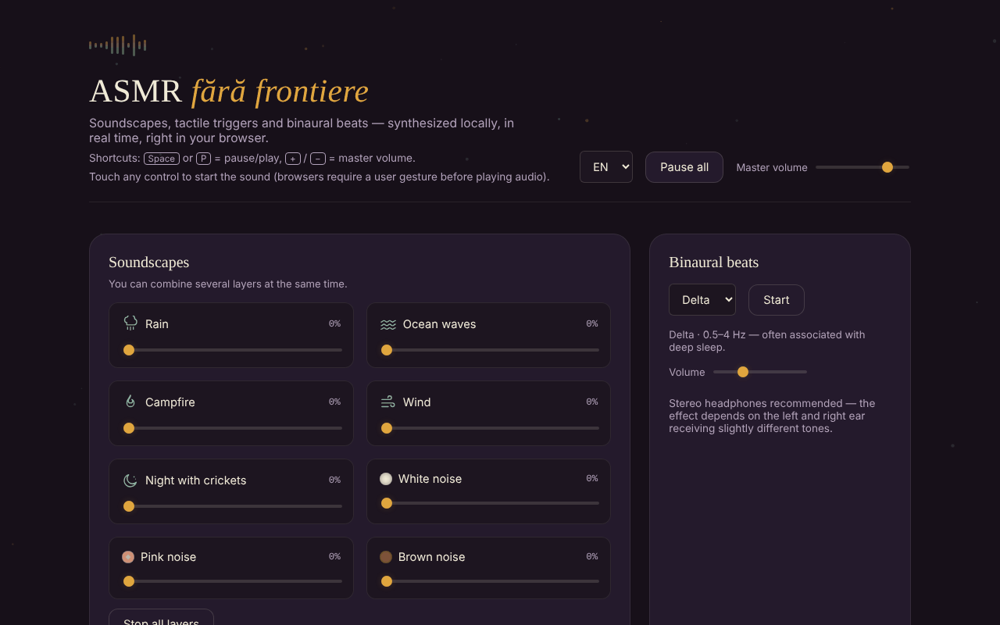

# ASMR fără frontiere

**English** · [Română](README.ro.md) · [Français](README.fr.md) · [Italiano](README.it.md) · [Español](README.es.md) · [Português](README.pt.md) · [Deutsch](README.de.md) · [Magyar](README.hu.md)

**Version:** 1.2.5 · **Last updated:** 2026-10-23

Interface languages: **Română, English, Français, Italiano, Español, Português (PT), Deutsch, Magyar**

Soundscapes, tactile triggers and binaural beats, synthesised locally in the browser, in a single HTML file.

**Live:** https://chiuta.github.io/ASMR/

## What it is

A sound mixer for relaxation, written in plain JavaScript. The sound is not played from audio files: it is generated in real time through the Web Audio API. The app brings together combinable ambient layers, short sounds triggered by touch, interactive visual effects, binaural beats and a sleep timer.

## Features

- **Soundscapes** (combinable layers, each with its own volume): Rain, Ocean waves, Campfire, Wind, Night with crickets, White noise, Pink noise, Brown noise.
- **Triggers**: Wood tapping, Glass tapping, Table tapping, Water drop, Page turn, Keyboard click, Paper rustle and Brushing (a continuous texture for as long as you hold it down).
- **ASMR visual effects**: Kinetic sand, Bubble wrap, Ink in water, Cracking ice, Symmetric pattern, Light waves; **Clear** button.
- **Binaural beats**: the Delta, Theta, Alpha and Beta bands, with a separate volume and a **Start** button. The app recommends stereo headphones.
- **Sleep timer**: 15, 30, 45, 60 or 90 min, or "Off"; display of the time remaining.
- **Presets**: six built-in presets (Night rain, Ocean storm, Campfire, Focus, Falling asleep, Calm) and your own presets, saved with a name (maximum 24 characters).
- **Mix shareable by link**: "Copy mix link" generates an address with `#mix=…` (the active layers with volume and, if it is on, the binaural band). Whoever opens the link sees the "Play the mix from the link" button; the sound does not start by itself. The values in the link are validated (only known layers, volume 1–100). The presets show status messages (missing name, saved, link copied).
- **Pause all / Play all** button and **Master volume**; **Stop all layers** button (brings the layers to 0 and stops the binaural beats).
- Timer with **custom duration** (1–480 min, with an error message for an invalid value); the timer has the `timer` role for screen readers.
- The **Last combination** preset: the last mix with at least one layer or beats active is kept automatically and can be resumed with one click.
- Global shortcuts: **Space** or **P** = pause/play, **+** / **−** = master volume (±5), when focus is not on a field or button.
- The Enter and Space keys activate the triggers when they have focus.

## New features (v1.1.0)

- **WAV recording of the current mix**: captures the app's output in real time (the active layers, the binaural beats and the triggers touched during that time), stereo, 16-bit, for the chosen duration (15 s – 5 min) or until "Stop and save"; the file `asmr-mix-*.wav` is downloaded at the end. With no active sound it refuses with a message. Limit: the recording lasts as long as the sound (real time, not accelerated rendering) and uses `ScriptProcessorNode`; if the browser does not have it, a message appears.
- **QR for the mix**: generates a QR code with the layer levels (and the binaural beats) and can read it back from an image or from pasted text; the QR without a web link contains only `#mix=…`. An image without a QR changes nothing.
- **Breathing voice guide** (`FFF.tts`): says "Breathe in" (4 s) and "Breathe out" (6 s) at a slow pace, with visible text and `aria-pressed`; without speech synthesis a message appears. It is not medical advice.
- **Kit**: Transparency and `.fff.json` backup (the presets are indexed), the modules `core, label, bundle, qr, tts`.
- **Languages and translations**: The app has an interface in Romanian only; the new texts are in Romanian. The kit's "Transparency" dialog is in 8 languages (machine translations, **not verified by native speakers**).

## User guide

1. Open the page and touch any control: the browser requires a user gesture before playing audio.
2. In "Soundscapes", raise the slider of one or more layers; adjust "Master volume".
3. In "Triggers", touch a button for a short sound; for "Brushing" hold it down for as long as you want the texture.
4. In "ASMR visual effects", choose an effect and interact with it; "Clear" resets it.
5. In "Binaural beats", choose the band (Delta, Theta, Alpha or Beta), adjust the volume and press **Start**.
6. For falling asleep, choose the duration in "Sleep timer"; the sound stops when the time expires. "Off" cancels the timer.
7. In "Presets", press a built-in preset or type a name (Enter or **Save**) to save your current combination of layers and the active binaural band.
8. **Pause all** temporarily stops all sounds; the same button resumes them.

## Warning

Informational and relaxation content; it does not replace medical advice. The descriptions of the binaural bands (Delta, Theta, Alpha, Beta) are popular associations; the scientific evidence for their effect on sleep, concentration or mood is limited, and the app is not a medical device and does not treat any condition. Keep the volume at a comfortable level; if you have epilepsy, tinnitus or another condition, ask a doctor for advice before prolonged use.

## Privacy and network

- The "without borders" kit (`fff-kit`, modules `core, label, bundle, qr, tts`) is pasted into `index.html`: it makes no network requests. The "Transparency" dialog (click on the version) shows the declared network (0 external requests), the `localStorage` keys, the SHA-256 of the file and offers a `.fff.json` backup (optionally encrypted with a password, AES-GCM). QR codes are generated and read locally; reading is done only from an image chosen by the user, without a camera.

- **Local storage (localStorage):** two keys: `asmr_ff_presets` (your saved presets: name, layer levels, binaural band) and `asmr_ff_last` (the last combination: levels and band, without a name). If the browser blocks storage, the presets stay in memory only until reload.
- **Network:** there are no network requests (`fetch`), scripts, fonts or images loaded from outside in the code, and no external links. There are no analytics.

## Running locally / offline

Download `index.html` and open it in a browser; it does not need internet. A browser with Web Audio API support and JavaScript enabled is required.

## History / Changelog

- 1.2.3 — 2026-10-22: fff-kit 1.1.4: touch targets and minimum text size
- 1.2.2 — 2026-10-22: fff-kit 1.1.2: PBKDF2 600,000 iterations, anti-clickjacking protection
- 1.2.1 — 2026-10-22: accessibility and mobile polish: the hidden QR file input is labelled, shortcut keys and slider touch targets meet the minimum size (≥12 px text, ≥24 px targets).
- 1.1.1 — 2026-10-18: importing a `.fff.json` bundle merges the imported presets with your own (same name = replaced with the one from the file; cap of 50) instead of deleting them; tests.
- 1.1.0 — 2026-10-14: WAV recording, QR for the mix, breathing voice guide, "without borders" kit. Tests: `tests/fff-r8.test.mjs`.

### 23 October 2026 (v1.2.5)
- Fix: a mix link with `b=toString` / `b=constructor` or a layer named `constructor` passed validation (keys inherited from `Object`) and threw an `AudioParam` error when applied; only own keys are accepted now
- New: `tests/r10-audit.test.mjs` (regression for hostile `#mix=` links)

### 12 October 2026 (v1.0.0)
- 1.0.0 — 2026-10-12: the version and the date of the last update are shown in the app

### 11 October 2026 (third entry)
- Mix shareable by link, applied only on pressing a button; status messages for the presets (previously, saving without a name gave no response).

### 11 October 2026
- New: custom duration for the timer, "Stop all layers", the "Last combination" preset, keyboard shortcuts; CSP with a hash for the script (no `'unsafe-inline'` for scripts). Screenshot updated.
- Added a strict CSP (no network, no external resources); check: axe 0 violations, no console errors, no horizontal overflow at 360 px.
- The quality of the synthesised sound cannot be evaluated automatically; unchanged in this round.

## License

MIT for the code and structure of the app — see the `LICENSE` file. Any third-party libraries included in the file keep their own licences.

The app itself contains only the statement: "The file is yours. 100% local — no account, no telemetry, no server."

## Author

Alexio — Alexandru-Ionuț Chiuță. Contact: alexio@trom.tf

## Summary

ASMR fără frontiere is a single-file ASMR sound mixer: layered soundscapes (rain, ocean, fire, wind, crickets, white/pink/brown noise), touch triggers, interactive visual effects, binaural beats (Delta/Theta/Alpha/Beta) and a sleep timer, all synthesised live with the Web Audio API. It makes no network requests; only user-saved presets are kept in localStorage. UI is in Romanian. License: MIT.

Audit: 2026-10-10 — code checked (no network requests), accessibility (axe) and operation; warning added.
