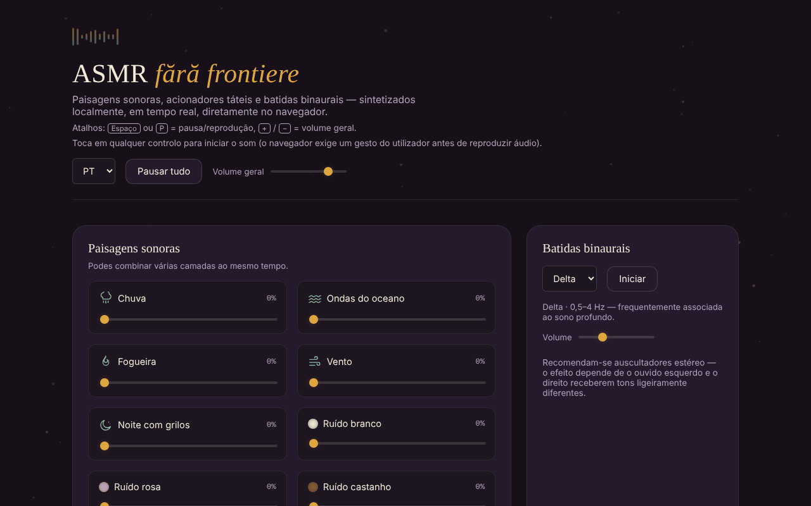

# ASMR fără frontiere

[English](README.md) · [Română](README.ro.md) · [Français](README.fr.md) · [Italiano](README.it.md) · [Español](README.es.md) · **Português** · [Deutsch](README.de.md) · [Magyar](README.hu.md)

**Versão:** 2.1.0 · **Última atualização:** 2026-10-27

**Estado:** estável · **Offline:** completo

Idiomas da interface: **Română, English, Français, Italiano, Español, Português (PT), Deutsch, Magyar**

Paisagens sonoras, estímulos táteis e batimentos binaurais, sintetizados localmente no navegador, num único ficheiro HTML.

**Online:** https://chiuta.github.io/ASMR/

## O que é

Um misturador de sons para relaxamento, escrito em JavaScript simples. O som não é reproduzido a partir de ficheiros de áudio: é gerado em tempo real através da Web Audio API. A aplicação reúne camadas de ambiente combináveis, sons curtos acionados ao toque, efeitos visuais interativos, batimentos binaurais e um temporizador para adormecer.

## Funcionalidades

- **Paisagens sonoras** (camadas combináveis, cada uma com o seu próprio volume): Chuva, Ondas do oceano, Fogueira, Vento, Noite com grilos, Ruído branco, Ruído rosa, Ruído castanho.
- **Estímulos**: Pancadinhas na madeira, Pancadinhas no vidro, Pancadinhas na mesa, Gota de água, Página virada, Clique de teclado, Restolhar de papel e Escovagem (textura contínua enquanto mantém premido).
- **Efeitos visuais ASMR**: Areia cinética, Plástico de bolhas, Tinta na água, Gelo a rachar, Padrão simétrico, Ondas de luz; botão **Limpar**.
- **Batimentos binaurais**: as bandas Delta, Theta, Alpha e Beta, com volume separado e botão **Iniciar**. A aplicação recomenda auscultadores estéreo.
- **Temporizador para adormecer**: 15, 30, 45, 60 ou 90 min, ou «Desligado»; apresentação do tempo restante.
- **Predefinições**: seis predefinições integradas (Chuva noturna, Tempestade no oceano, Fogueira, Concentração, Adormecer, Calma) e predefinições próprias, guardadas com um nome (máximo 24 carateres).
- **Mistura partilhável por ligação**: «Copiar a ligação da mistura» gera um endereço com `#mix=…` (as camadas ativas com volume e, se estiver ligada, a banda binaural). Quem abre a ligação vê o botão «Reproduzir a mistura da ligação»; o som não arranca sozinho. Os valores da ligação são validados (apenas camadas conhecidas, volume 1–100). As predefinições mostram mensagens de estado (nome em falta, guardado, ligação copiada).
- Botão **Pausar tudo / Reproduzir tudo** e **Volume geral**; botão **Parar todas as camadas** (leva as camadas a 0 e para os batimentos binaurais).
- Temporizador com **duração personalizada** (1–480 min, com mensagem de erro para valor inválido); o temporizador tem o papel `timer` para os leitores de ecrã.
- A predefinição **Última combinação**: a última mistura com pelo menos uma camada ou batimentos ativos é guardada automaticamente e pode ser retomada com um clique.
- Atalhos globais: **Espaço** ou **P** = pausa/reprodução, **+** / **−** = volume geral (±5), quando o foco não está num campo ou botão.
- As teclas Enter e Espaço ativam os estímulos quando estes têm o foco.

## Novidades (v1.1.0)

- **Gravação WAV da mistura atual**: capta em tempo real a saída da aplicação (as camadas ativas, os batimentos binaurais e os estímulos tocados durante esse tempo), estéreo, 16 bits, durante a duração escolhida (15 s – 5 min) ou até «Parar e guardar»; o ficheiro `asmr-mix-*.wav` é descarregado no final. Sem som ativo recusa com uma mensagem. Limite: a gravação dura o mesmo que o som (tempo real, não renderização acelerada) e usa `ScriptProcessorNode`; se o navegador não o tiver, aparece uma mensagem.
- **QR para a mistura**: gera um código QR com os níveis das camadas (e os batimentos binaurais) e pode lê-lo de volta a partir de uma imagem ou de texto colado; o QR sem ligação web contém apenas `#mix=…`. Uma imagem sem QR não altera nada.
- **Guia de voz para a respiração** (`FFF.tts`): diz «Inspire» (4 s) e «Expire» (6 s) a um ritmo lento, com texto visível e `aria-pressed`; sem síntese de voz aparece uma mensagem. Não é uma indicação médica.
- **Kit**: Transparência e cópia `.fff.json` (as predefinições são indexadas), módulos `core, label, bundle, qr, tts`.
- **Idiomas e traduções**: a aplicação tem interface apenas em romeno; os textos novos estão em romeno. A caixa de diálogo «Transparência» do kit está em 8 idiomas (traduções automáticas, **não verificadas por falantes nativos**).

## Manual de utilização

1. Abra a página e toque em qualquer controlo: o navegador exige um gesto do utilizador antes de reproduzir áudio.
2. Em «Paisagens sonoras», levante o cursor de uma ou mais camadas; ajuste o «Volume geral».
3. Em «Estímulos», toque num botão para um som curto; em «Escovagem», mantenha premido pelo tempo que quiser a textura.
4. Em «Efeitos visuais ASMR», escolha um efeito e interaja com ele; «Limpar» repõe-no.
5. Em «Batimentos binaurais», escolha a banda (Delta, Theta, Alpha ou Beta), ajuste o volume e prima **Iniciar**.
6. Para adormecer, escolha a duração em «Temporizador para adormecer»; o som para quando o tempo expira. «Desligado» cancela o temporizador.
7. Em «Predefinições», prima uma predefinição integrada ou escreva um nome (Enter ou **Guardar**) para guardar a sua combinação atual de camadas e a banda binaural ativa.
8. **Pausar tudo** interrompe temporariamente todos os sons; o mesmo botão retoma-os.

## Aviso

Conteúdo informativo e de relaxamento; não substitui o aconselhamento médico. As descrições das bandas binaurais (Delta, Theta, Alpha, Beta) são associações populares; as provas científicas sobre o seu efeito no sono, na concentração ou no estado de espírito são limitadas, e a aplicação não é um dispositivo médico nem trata qualquer afeção. Mantenha o volume num nível confortável; se tem epilepsia, acufenos ou outra afeção, peça o parecer de um médico antes de uma utilização prolongada.

## Privacidade e rede

- O kit «sem fronteiras» (`fff-kit`, módulos `core, label, bundle, qr, tts`) está incorporado em `index.html`: não faz pedidos de rede. A caixa de diálogo «Transparência» (clique na versão) mostra a rede declarada (0 pedidos externos), as chaves de `localStorage`, o SHA-256 do ficheiro e oferece uma cópia de segurança `.fff.json` (opcionalmente cifrada com palavra-passe, AES-GCM). Os códigos QR são gerados e lidos localmente; a leitura faz-se apenas a partir de uma imagem escolhida pelo utilizador, sem câmara.

- **Armazenamento local (localStorage):** duas chaves: `asmr_ff_presets` (as suas predefinições guardadas: nome, níveis das camadas, banda binaural) e `asmr_ff_last` (a última combinação: níveis e banda, sem nome). Se o navegador bloquear o armazenamento, as predefinições ficam apenas em memória até recarregar.
- **Rede:** no código não existem pedidos de rede (`fetch`), nem scripts, tipos de letra ou imagens carregados do exterior, nem ligações externas. Não há analítica.

## Execução local / offline

Descarregue `index.html` e abra-o no navegador; não precisa de internet. É necessário um navegador com suporte para a Web Audio API e JavaScript ativado.

## Sons novos e desvanecimento final configurável (2.1.0)

Três camadas novas, sintetizadas localmente: **Riacho**, **Ventoinha** e **Trovão distante** (estrondos raros, só enquanto a camada está ativa). **Desvanecimento final configurável** no fim do temporizador para adormecer: 10 s, 30 s (predefinido), 2 min ou 5 min; a escolha fica em `localStorage` (`asmr_ff_fade`). O temporizador já existia (15–90 min ou duração livre 1–480 min); se o desvanecimento for mais longo do que o tempo restante, começa de imediato. As camadas novas entram automaticamente nas predefinições, na ligação `#mix=`, no código QR e nas cenas.

## Ver também: aplicações afins (não fundidas)

Estas aplicações sobrepõem-se no objetivo (som calmante para relaxar e dormir), mas funcionam de modo diferente e **não foram fundidas**. **ASMR** é um misturador de paisagens sonoras e gatilhos táteis (ASMR), com cenas temporais e temporizador para adormecer. Ver também: [CalmWaves](https://chiuta.github.io/CalmWaves/) — uma composição ambiente generativa (intenção, paleta tonal, densidade) com código de variante, voz sintetizada e visualizações; [BorderlessMelodies](https://chiuta.github.io/BorderlessMelodies/) — um compositor de música original por género e semente (exportação WAV/FLAC/MIDI, códigos partilháveis), com camadas de relaxamento opcionais; [Aurora](https://chiuta.github.io/Aurora/) — tons dos chakras, batimentos binaurais e guia de respiração para meditação. Escolha conforme a necessidade: paisagens e gatilhos = ASMR; peça ambiente gerada = CalmWaves; música por género/semente = BorderlessMelodies; meditação de chakras = Aurora.

## Histórico / Changelog
- **2.1.0 — 2026-10-27:** camadas novas (Riacho, Ventoinha, Trovão distante); duração do desvanecimento do temporizador configurável (10 s / 30 s / 2 min / 5 min); nota «ver também» (CalmWaves, BorderlessMelodies, Aurora), sem fusão; linhas Estado/Offline; CHANGELOG.md (anterior: v2.0.0).

- 1.2.3 — 2026-10-22: fff-kit 1.1.4: alvos de toque e tamanho mínimo do texto
- 1.2.2 — 2026-10-22: fff-kit 1.1.2: PBKDF2 600 000 iterações, proteção anti-clickjacking
- 1.2.1 — 2026-10-22: melhorias de acessibilidade e telemóvel: o campo oculto da imagem QR tem etiqueta, as teclas de atalho e as áreas táteis dos controlos deslizantes cumprem o tamanho mínimo (texto ≥ 12 px, áreas ≥ 24 px).
- 1.1.1 — 2026-10-18: a importação de um pacote `.fff.json` junta as predefinições importadas às próprias (mesmo nome = substituído pelo do ficheiro; limite de 50) em vez de as apagar; testes.
- 1.1.0 — 2026-10-14: gravação WAV, QR para a mistura, guia de voz para a respiração, kit «sem fronteiras». Testes: `tests/fff-r8.test.mjs`.

### 12 de outubro de 2026 (v1.0.0)
- 1.0.0 — 2026-10-12: a versão e a data da última atualização são apresentadas na aplicação

### 11 de outubro de 2026 (terceira entrada)
- Mistura partilhável por ligação, aplicada apenas ao premir um botão; mensagens de estado nas predefinições (antes, guardar sem nome não dava qualquer resposta).

### 11 de outubro de 2026
- Novo: duração personalizada do temporizador, «Parar todas as camadas», predefinição «Última combinação», atalhos de teclado; CSP com hash para o script (sem `'unsafe-inline'` nos scripts). Captura de ecrã atualizada.
- Adicionada uma CSP estrita (sem rede, sem recursos externos); verificação: axe 0 violações, sem erros na consola, sem excesso horizontal a 360 px.
- A qualidade do som sintetizado não pode ser avaliada automaticamente; inalterada nesta ronda.

## Licença

MIT para o código e a estrutura da aplicação — ver o ficheiro `LICENSE`. As eventuais bibliotecas de terceiros incluídas no ficheiro mantêm as suas próprias licenças.

A aplicação em si contém apenas a menção: «O ficheiro é teu. 100% local — sem conta, sem telemetria, sem servidor.»

## Autor

Alexio — Alexandru-Ionuț Chiuță. Contacto: alexio@trom.tf

## Resumo

A ASMR fără frontiere é um misturador de sons ASMR de ficheiro único: paisagens sonoras por camadas (chuva, oceano, fogo, vento, grilos, ruído branco/rosa/castanho), estímulos táteis, efeitos visuais interativos, batimentos binaurais (Delta/Theta/Alpha/Beta) e um temporizador para adormecer, tudo sintetizado em direto com a Web Audio API. Não faz pedidos de rede; apenas as predefinições guardadas pelo utilizador ficam em localStorage. A interface está em romeno. Licença: MIT.

Auditoria: 2026-10-10 — código verificado (sem pedidos de rede), acessibilidade (axe) e funcionamento; adicionado um aviso.
